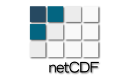
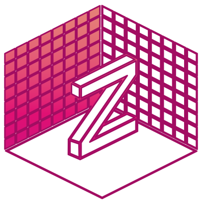
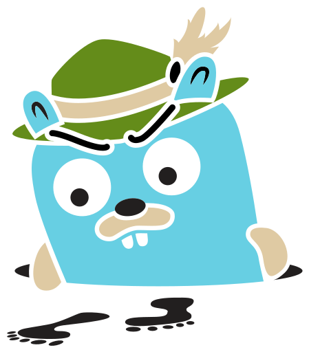
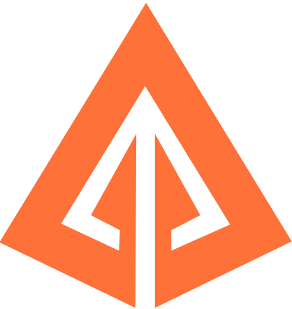
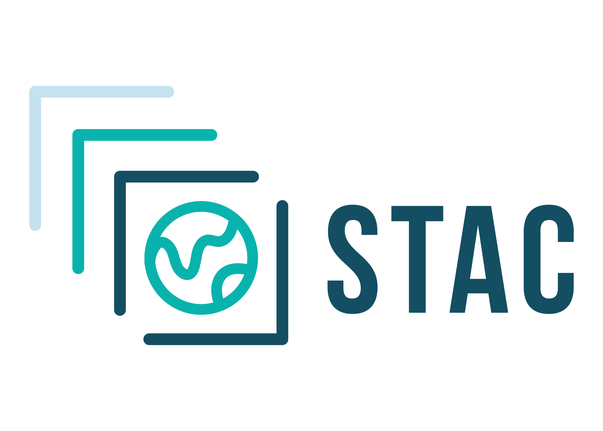

Library overview

# Big data loading for the web.

Load large files, streams, and cloud-hosted datasets in the browser or Node.js. Use one small API to parse, scan, transform, and write the formats your application needs.

This documentation describes loaders.gl **v5**. See our

<!-- -->

[release notes](https://loaders.gl/next/docs/whats-new.md) to learn what is new. Older versions:

<!-- -->

[v4.4](https://github.com/visgl/loaders.gl/blob/4.4-release/docs/README.md),

<!-- -->

[v3.3](https://github.com/visgl/loaders.gl/blob/3.3-release/docs/README.md),

<!-- -->

[v2.3](https://github.com/visgl/loaders.gl/blob/2.3-release/docs/README.md),

<!-- -->

[v1.3](https://github.com/visgl/loaders.gl/blob/1.3-release/docs/README.md).

[Get started](https://loaders.gl/next/docs/developer-guide/get-started.md)

<!-- -->

[ ↗](https://loaders.gl/next/docs/developer-guide/get-started.md)[Modules](https://loaders.gl/next/docs/modules.md)

<!-- -->

[ ↗](https://loaders.gl/next/docs/modules.md)[Loader categories](https://loaders.gl/next/docs/developer-guide/loader-categories.md)

<!-- -->

[ ↗](https://loaders.gl/next/docs/developer-guide/loader-categories.md)[Common scan architecture](https://loaders.gl/next/docs/developer-guide/common-scan-architecture.md)

<!-- -->

[ ↗](https://loaders.gl/next/docs/developer-guide/common-scan-architecture.md)

## Explore formats[​](#explore-formats "Direct link to Explore formats")

loaders.gl supports tabular, geospatial, 3D, texture, archive, and interchange formats. Official project logos are used where available. Other formats use simple name badges; OGC standards pair the OGC mark with the format name.

AllTablesGeospatialServicesTexturesPointcloudsMeshes

[BSON](https://loaders.gl/next/docs/modules/documents/bson/formats/bson.md "BSON")[TOMLTOML](https://loaders.gl/next/docs/modules/documents/config/formats/toml.md "TOML")[YAML](https://loaders.gl/next/docs/modules/documents/config/formats/yaml.md "YAML")[MDMarkdown](https://loaders.gl/next/docs/modules/documents/formats/markdown.md "Markdown")[HTMLHTML](https://loaders.gl/next/docs/modules/documents/xml/formats/html.md "HTML")[XMLXML](https://loaders.gl/next/docs/modules/documents/xml/formats/xml.md "XML")[Arrow](https://loaders.gl/next/docs/modules/tables/arrow/formats/arrow.md "Arrow")[GeoArrowGeoArrow](https://loaders.gl/next/docs/modules/tables/arrow/formats/geoarrow.md "GeoArrow")[CSVCSV](https://loaders.gl/next/docs/modules/tables/csv/formats/csv.md "CSV")[GeoJSONGeoJSON](https://loaders.gl/next/docs/modules/tables/json/formats/geojson.md "GeoJSON")[JSONJSON](https://loaders.gl/next/docs/modules/tables/json/formats/json.md "JSON")[ORC](https://loaders.gl/next/docs/modules/tables/orc/formats/orc.md "ORC")[GeoParquetGeoParquet](https://loaders.gl/next/docs/modules/tables/parquet/formats/geoparquet.md "GeoParquet")[Parquet](https://loaders.gl/next/docs/modules/tables/parquet/formats/parquet.md "Parquet")[FlatGeobuf](https://loaders.gl/next/docs/modules/geospatial/flatgeobuf/formats/flatgeobuf.md "FlatGeobuf")[OGCGeoPackageGeoPackage](https://loaders.gl/next/docs/modules/geospatial/geopackage/formats/geopackage.md "GeoPackage")[GPXGPX](https://loaders.gl/next/docs/modules/geospatial/kml/formats/gpx.md "GPX")[OGCKMLKML](https://loaders.gl/next/docs/modules/geospatial/kml/formats/kml.md "KML")[TCXTCX](https://loaders.gl/next/docs/modules/geospatial/kml/formats/tcx.md "TCX")[SHPShapefile](https://loaders.gl/next/docs/modules/geospatial/shapefile/formats/shapefile.md "Shapefile")[TWKBTWKB](https://loaders.gl/next/docs/modules/geospatial/wkt/formats/twkb.md "TWKB")[OGCWKBWKB](https://loaders.gl/next/docs/modules/geospatial/wkt/formats/wkb.md "WKB")[OGCWKT-CRSWKT-CRS](https://loaders.gl/next/docs/modules/geospatial/wkt/formats/wkt-crs.md "WKT-CRS")[OGCWKTWKT](https://loaders.gl/next/docs/modules/geospatial/wkt/formats/wkt.md "WKT")[BASISBasis](https://loaders.gl/next/docs/modules/images/textures/formats/basis.md "Basis")[GPUCompressed Textures](https://loaders.gl/next/docs/modules/images/textures/formats/compressed-textures.md "Compressed Textures")[CrunchCrunch](https://loaders.gl/next/docs/modules/images/textures/formats/crunch.md "Crunch")[DDSDDS](https://loaders.gl/next/docs/modules/images/textures/formats/dds.md "DDS")[HDRRadiance HDR](https://loaders.gl/next/docs/modules/images/textures/formats/hdr.md "Radiance HDR")[KTX / KTX2](https://loaders.gl/next/docs/modules/images/textures/formats/ktx.md "KTX / KTX2")[PVRPVR](https://loaders.gl/next/docs/modules/images/textures/formats/pvr.md "PVR")[LASLAS](https://loaders.gl/next/docs/modules/pointclouds/las/formats/las.md "LAS")[PCDPCD](https://loaders.gl/next/docs/modules/pointclouds/pcd/formats/pcd.md "PCD")[PLYPLY](https://loaders.gl/next/docs/modules/pointclouds/ply/formats/ply.md "PLY")[MLTMapLibre Tile](https://loaders.gl/next/docs/modules/tiles/mlt/formats/mlt.md "MapLibre Tile")[STYLEMap Style](https://loaders.gl/next/docs/modules/tiles/mvt/formats/map-style.md "Map Style")[MVTMVT](https://loaders.gl/next/docs/modules/tiles/mvt/formats/mvt.md "MVT")[TileJSONTileJSON](https://loaders.gl/next/docs/modules/tiles/mvt/formats/tilejson.md "TileJSON")[PMTilesPMTiles](https://loaders.gl/next/docs/modules/tiles/pmtiles/formats/pmtiles.md "PMTiles")[3D Tiles](https://loaders.gl/next/docs/modules/tiles-3d/3d-tiles/formats/3d-tiles.md "3D Tiles")[COPC](https://loaders.gl/next/docs/modules/tiles-3d/copc/formats/copc.md "COPC")[OGCI3SI3S](https://loaders.gl/next/docs/modules/tiles-3d/i3s/formats/i3s.md "I3S")[PotreePotree](https://loaders.gl/next/docs/modules/tiles-3d/potree/formats/potree.md "Potree")[OGCGeoTIFFGeoTIFF](https://loaders.gl/next/docs/modules/raster/geotiff/formats/geotiff.md "GeoTIFF")[LERCLERC](https://loaders.gl/next/docs/modules/raster/lerc/formats/lerc.md "LERC")[NPYNumPy NPY](https://loaders.gl/next/docs/modules/scientific/formats/npy.md "NumPy NPY")[NetCDFNetCDF](https://loaders.gl/next/docs/modules/scientific/netcdf/formats/netcdf.md "NetCDF")[ZarrZarr](https://loaders.gl/next/docs/modules/scientific/zarr/formats/zarr.md "Zarr")[Draco](https://loaders.gl/next/docs/modules/scene/draco/formats/draco.md "Draco")[GLBGLB](https://loaders.gl/next/docs/modules/scene/gltf/formats/glb.md "GLB")[glTF](https://loaders.gl/next/docs/modules/scene/gltf/formats/gltf.md "glTF")[OBJOBJ](https://loaders.gl/next/docs/modules/scene/obj/formats/obj.md "OBJ")[OpenUSDOpenUSD](https://loaders.gl/next/docs/modules/scene/usd/formats/usd.md "OpenUSD")[ZIPZIP](https://loaders.gl/next/docs/modules/archives/zip/formats/zip.md "ZIP")[Chrome TraceChrome Trace](https://loaders.gl/next/docs/modules/traces/formats/chrome-trace.md "Chrome Trace")[JaegerJaeger](https://loaders.gl/next/docs/modules/traces/formats/jaeger-trace.md "Jaeger")[OTLPOTLP](https://loaders.gl/next/docs/modules/traces/formats/otlp-trace.md "OTLP")[PerfettoPerfetto Trace](https://loaders.gl/next/docs/modules/traces/formats/perfetto-trace.md "Perfetto Trace")[ZipkinZipkin](https://loaders.gl/next/docs/modules/traces/formats/zipkin-trace.md "Zipkin")[STACSTAC](https://loaders.gl/next/docs/modules/ogc/stac/formats/stac.md "STAC")[OGCCSWCSW](https://loaders.gl/next/docs/modules/ogc/wms/formats/csw.md "CSW")[OGCGMLGML](https://loaders.gl/next/docs/modules/ogc/wms/formats/gml.md "GML")[OGCOWS ContextOWS Context](https://loaders.gl/next/docs/modules/ogc/wms/formats/ows-context.md "OWS Context")[OGCWCSWCS](https://loaders.gl/next/docs/modules/ogc/wms/formats/wcs.md "WCS")[OGCWFSWFS](https://loaders.gl/next/docs/modules/ogc/wms/formats/wfs.md "WFS")[OGCWMCWMC](https://loaders.gl/next/docs/modules/ogc/wms/formats/wmc.md "WMC")[OGCWMSWMS](https://loaders.gl/next/docs/modules/ogc/wms/formats/wms.md "WMS")[OGCWMTSWMTS](https://loaders.gl/next/docs/modules/ogc/wms/formats/wmts.md "WMTS")[OGCAPIOGC API Services](https://loaders.gl/next/docs/modules/ogc/wms/services/ogc-api.md "OGC API Services")[FeatureArcGIS Feature Server](https://loaders.gl/next/docs/modules/arcgis/formats/arcgis-feature-server.md "ArcGIS Feature Server")[ImageArcGIS Image Server](https://loaders.gl/next/docs/modules/arcgis/formats/arcgis-image-server.md "ArcGIS Image Server")[MapArcGIS MapServer](https://loaders.gl/next/docs/modules/arcgis/formats/arcgis-map-server.md "ArcGIS MapServer")[SceneArcGIS Scene Server](https://loaders.gl/next/docs/modules/arcgis/formats/arcgis-scene-server.md "ArcGIS Scene Server")[Vector TileArcGIS VectorTileServer](https://loaders.gl/next/docs/modules/arcgis/formats/arcgis-vector-tile-server.md "ArcGIS VectorTileServer")[AvroAvro](https://loaders.gl/next/docs/modules/tables/avro.md "Avro")[Lance](https://loaders.gl/next/docs/modules/tables/lance.md "Lance")[Delta LakeDelta Lake](https://loaders.gl/next/docs/modules/tables/delta/format.md "Delta Lake")[Apache Iceberg](https://loaders.gl/next/docs/modules/tables/iceberg/format.md "Apache Iceberg")[Apache Hudi](https://loaders.gl/next/docs/modules/tables/hudi/format.md "Apache Hudi")[TerrainTerrain](https://loaders.gl/next/docs/modules/raster/terrain.md "Terrain")[HDF5HDF5](https://loaders.gl/next/docs/modules/scientific/hdf5.md "HDF5")[GRIB2GRIB2](https://loaders.gl/next/docs/modules/scientific/grib2.md "GRIB2")[VTK](https://loaders.gl/next/docs/modules/scientific/vtk.md "VTK")[TARTAR](https://loaders.gl/next/docs/modules/archives/tar.md "TAR")[DOTDOT](https://loaders.gl/next/docs/modules/graphs.md "DOT")[GraphMLGraphML](https://loaders.gl/next/docs/modules/graphs.md "GraphML")[GEXFGEXF](https://loaders.gl/next/docs/modules/graphs.md "GEXF")[SplatSplat](https://loaders.gl/next/docs/modules/splats/formats/splats.md "Splat")[KSplatKSplat](https://loaders.gl/next/docs/modules/splats/formats/splats.md "KSplat")[SPZSPZ](https://loaders.gl/next/docs/modules/splats/formats/splats.md "SPZ")[RADRAD](https://loaders.gl/next/docs/modules/splats/formats/splats.md "RAD")[ImagesImages](https://loaders.gl/next/docs/modules/images.md "Images")[VideoVideo](https://loaders.gl/next/docs/modules/images/video.md "Video")[GIFGIF](https://loaders.gl/next/docs/modules/images/video.md "GIF")[APIArcGIS API Reference](https://loaders.gl/next/docs/modules/arcgis.md "ArcGIS API Reference")

The loaders.gl model

## Add formats. Your app just works.

Independent modules turn files, streams, services, and datasets into predictable data for JavaScript applications. Start with one format and add capabilities as the application grows.

01

Start with

load() for one complete result

02

Scale up with

loadInBatches() for incremental work

03

Common shapes

Tables, geometry, images, textures, and scenes

04

Install

Owner packages and the optional runtimes your formats need

## Start here[​](#start-here "Direct link to Start here")

Choose the loader that matches your data and use the same small set of APIs to load, stream, or write it. Related formats share owner packages. Install the packages you need and use their format subpaths to select APIs and defer parsers. Browse [Modules](https://loaders.gl/next/docs/modules.md) to find the package for your format.

[](https://coveralls.io/github/visgl/loaders.gl?branch=master)[](https://github.com/visgl/loaders.gl)[](https://github.com/visgl/loaders.gl/graphs/contributors)[](https://github.com/visgl/loaders.gl/pulls?q=is%3Apr)

[](https://openvisualization.org)

*loaders.gl is an OpenJS Foundation / Linux Foundation project.*

Detailed guide

## The full library map

The guide below covers categories, packages, file formats, service sources, and the details behind the common APIs.

## Overview[​](#overview "Direct link to Overview")

loaders.gl is a collection of composable TypeScript modules for loading, scanning, transforming, and writing data in JavaScript applications. It covers tabular, geospatial, imagery, and 3D formats with consistent APIs for complete results, streamed batches, workers, and remote sources.

The modules are framework agnostic. Use them with any JavaScript application, or combine them with [vis.gl frameworks](https://vis.gl/frameworks) such as [**deck.gl**](https://deck.gl) when loaded data should be visualized.

## Loaders[​](#loaders "Direct link to Loaders")

loaders.gl provides a wide selection of loaders organized into categories:

| Category                                                                                         | Loaders                                                                                                                                                                                                                                                                                                                                                                                                                                                                                                                                                                                                                                          |
| ------------------------------------------------------------------------------------------------ | ------------------------------------------------------------------------------------------------------------------------------------------------------------------------------------------------------------------------------------------------------------------------------------------------------------------------------------------------------------------------------------------------------------------------------------------------------------------------------------------------------------------------------------------------------------------------------------------------------------------------------------------------ |
| [Table Loaders](https://loaders.gl/next/docs/specifications/category-table.md)              | Streaming tabular loaders for [CSV](https://loaders.gl/next/docs/modules/tables/csv/api-reference/csv-loader.md), [JSON](https://loaders.gl/next/docs/modules/tables/json/api-reference/json-loader.md), [Parquet](https://loaders.gl/next/docs/modules/tables/parquet/api-reference/parquet-loader.md), [Arrow](https://loaders.gl/next/docs/modules/tables/arrow/api-reference/arrow-loader.md), and loaders that can return Arrow tables with `shape: 'arrow-table'`                                                                                                                                                      |
| [Geospatial Loaders](https://loaders.gl/next/docs/specifications/category-gis.md)           | Loaders for formats such as [GeoJSON](https://loaders.gl/next/docs/modules/tables/json/api-reference/geojson-loader.md), [KML](https://loaders.gl/next/docs/modules/geospatial/kml/api-reference/kml-loader.md), [WKT/WKB](https://loaders.gl/next/docs/modules/geospatial/wkt/api-reference/wkt-loader.md), and [Mapbox Vector Tiles](https://loaders.gl/next/docs/modules/tiles/mvt/api-reference/mvt-loader.md).                                                                                                                                                                                                          |
| [Image Loaders](https://loaders.gl/next/docs/specifications/category-image.md)              | Loaders for [images](https://loaders.gl/next/docs/modules/images/api-reference/image-loader.md) and image utilities such as the [parsed image API](https://loaders.gl/next/docs/modules/images/api-reference/parsed-image-api.md) and [binary image API](https://loaders.gl/next/docs/modules/images/api-reference/binary-image-api.md).                                                                                                                                                                                                                                                                                          |
| [Texture Loaders](https://loaders.gl/next/docs/specifications/category-texture.md)          | Loaders for [compressed textures](https://loaders.gl/next/docs/modules/images/textures/api-reference/compressed-texture-loader.md), [Basis textures](https://loaders.gl/next/docs/modules/images/textures/api-reference/basis-loader.md), and manifest-driven [texture loaders](https://loaders.gl/next/docs/modules/images/textures/api-reference/texture-loader.md) for arrays, cubemaps, and mip chains.                                                                                                                                                                                                                       |
| [Pointcloud and Mesh Loaders](https://loaders.gl/next/docs/specifications/category-mesh.md) | Loaders for point cloud and simple mesh formats such as [Draco](https://loaders.gl/next/docs/modules/scene/draco/api-reference/draco-loader.md), [LAS](https://loaders.gl/next/docs/modules/pointclouds/las/api-reference/las-loader.md), [PCD](https://loaders.gl/next/docs/modules/pointclouds/pcd/api-reference/pcd-loader.md), [PLY](https://loaders.gl/next/docs/modules/pointclouds/ply/api-reference/ply-loader.md), [OBJ](https://loaders.gl/next/docs/modules/scene/obj/api-reference/obj-loader.md), and [Terrain](https://loaders.gl/next/docs/modules/raster/terrain/api-reference/terrain-loader.md). |
| [Scenegraph Loaders](https://loaders.gl/next/docs/specifications/category-scenegraph.md)    | [glTF](https://loaders.gl/next/docs/modules/scene/gltf/api-reference/gltf-loader.md) and [OpenUSD](https://loaders.gl/next/docs/modules/scene/usd/api-reference/usd-loader.md) loaders                                                                                                                                                                                                                                                                                                                                                                                                                                                 |
| [Tiled Data Loaders](https://loaders.gl/next/docs/specifications/category-3d-tiles.md)      | Loaders for tiled 3D data such as [3D Tiles](https://loaders.gl/next/docs/modules/tiles-3d/3d-tiles/api-reference/tiles-3d-loader.md), [I3S](https://loaders.gl/next/docs/modules/tiles-3d/i3s/api-reference/i3s-loader.md), and [Potree](https://loaders.gl/next/docs/modules/tiles-3d/potree.md).                                                                                                                                                                                                                                                                                                                               |

## Code Examples[​](#code-examples "Direct link to Code Examples")

loaders.gl provides a small core API module with common functions to load and save data, and a range of optional modules that provide loaders and writers for specific file formats.

A minimal example using the `load` function and the `CSVLoader` to load a CSV file into an object-row table:

```
import {load} from '@loaders.gl/core';

import {CSVLoader} from '@loaders.gl/tables/csv';


const table = await load('data.csv', CSVLoader, {csv: {shape: 'object-row-table'}});


if (table.shape === 'object-row-table') {

  for (const row of table.data) {

    console.log(row);

  }

}
```

Streaming parsing is available using ES2018 async iterators, e.g. allowing "larger than memory" files to be incrementally processed:

```
import {loadInBatches} from '@loaders.gl/core';

import {CSVLoader} from '@loaders.gl/tables/csv';


for await (const batch of await loadInBatches('data.csv', CSVLoader, {csv: {shape: 'object-row-table'}})) {

  if (batch.batchType === 'data' && Array.isArray(batch.data)) {

    for (const row of batch.data) {

      console.log(JSON.stringify(row)); // => '{header1: value1, header2: value2}'

    }

  }

}
```

To quickly get up to speed on how the loaders.gl API works, see [Get Started](https://loaders.gl/next/docs/developer-guide/get-started.md).

## Supported Platforms[​](#supported-platforms "Direct link to Supported Platforms")

| Runtime            | Support                                                                      |
| ------------------ | ---------------------------------------------------------------------------- |
| Evergreen browsers | ✅ Current Chrome, Firefox, and Safari releases on desktop and mobile        |
| Node.js            | ✅ All current [LTS releases](https://nodejs.org/en/about/previous-releases) |

## Design Goals[​](#design-goals "Direct link to Design Goals")

| Goal                 | What it means in practice                                                                               |
| -------------------- | ------------------------------------------------------------------------------------------------------- |
| Arrow support        | Expose Arrow tables and record batches in supported tabular loaders for columnar processing.            |
| Binary-first data    | Preserve compact typed arrays and binary buffers without adding WebGL dependencies.                     |
| Streaming            | Process async input and parsed batches incrementally, including inputs larger than memory.              |
| Worker-ready parsing | Move expensive decoders to prebuilt workers when a module provides them.                                |
| Loader categories    | Normalize related formats into shared application-facing data shapes.                                   |
| Multi-asset loading  | Resolve linked buffers, images, tiles, and texture levels through one loading path.                     |
| Format autodetection | Select loaders from extensions, MIME types, and initial bytes when the input allows it.                 |
| Composable bundles   | Publish independent modules and lazy runtimes so applications can install what they use.                |
| Modern JavaScript    | Use TypeScript, ECMAScript modules, `ArrayBuffer`, and async iterators as portable primitives.          |
| Framework agnostic   | Return documented objects, typed arrays, tables, and batches that any JavaScript framework can consume. |
| Browser and Node.js  | Keep the same core APIs usable in browsers, services, scripts, and tests.                               |

## Licenses[​](#licenses "Direct link to Licenses")

loaders.gl itself is MIT licensed. Some modules include adapted code under compatible permissive licenses such as ISC, BSD, or Apache 2. Each module documents its own attributions and license boundary. Data, imagery and service content have separate terms.

## Credits and Attributions[​](#credits-and-attributions "Direct link to Credits and Attributions")

loaders.gl is maintained by a group of organizations collaborating through open governance under the OpenJS and Linux Foundations.

While loaders.gl contains substantial amounts of original code, it also repackages lots of superb work done by others in the open source community. We try to be as explicit as we can about the origins and attributions of each piece of code, both in the documentation page for each module and in the preservation of comments relating to authorship and contributions inside forked source code.

Even so, we can make mistakes, and we may not have the full history of the code we are reusing. If you think that we have missed something, or that we could do better in regard to attribution, please let us know.

See [Attributions and Credits](https://loaders.gl/next/docs/references-and-credits.md) for named authors, implementation lineage, specifications, fixture provenance and package notice inventories.

## Organizational support[​](#organizational-support "Direct link to Organizational support")

Organizations that have contributed significantly to the development and maintenance of loaders.gl:

[](https://studio.foursquare.com)[](https://carto.com)[](https://actionengine.com)[](https://esri.com)[](https://uber.com)

## Open Governance[​](#open-governance "Direct link to Open Governance")

loaders.gl is a part of the [**vis.gl framework suite**](https://vis.gl), an open governance Linux Foundation project that is developed collaboratively by multiple organizations and individuals and the Urban Computing Foundation.

[](https://vis.gl)

See [Get Started](https://loaders.gl/next/docs/developer-guide/get-started.md#install-packages-import-subpaths) for package installation and subpath imports.
