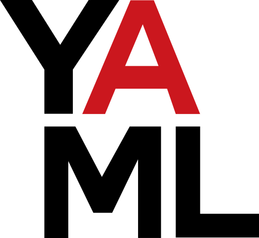
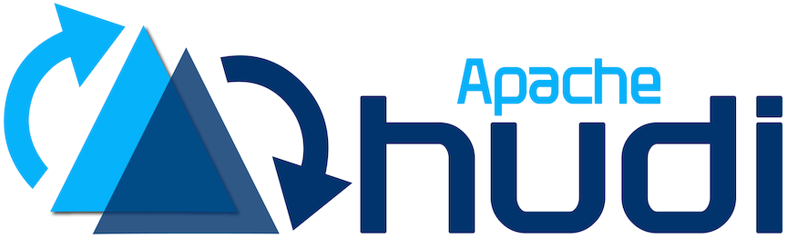
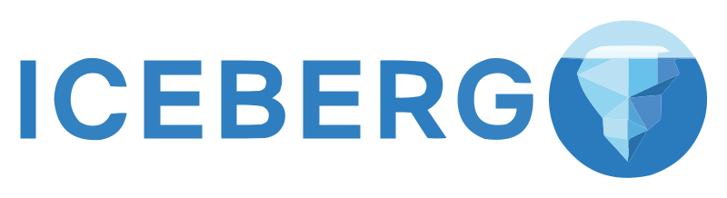
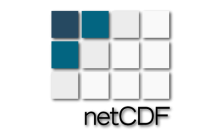
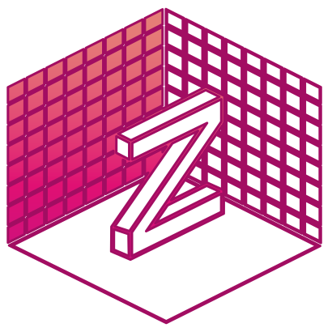
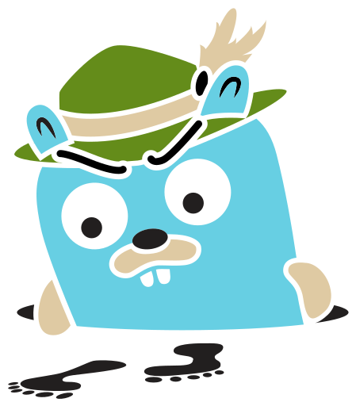
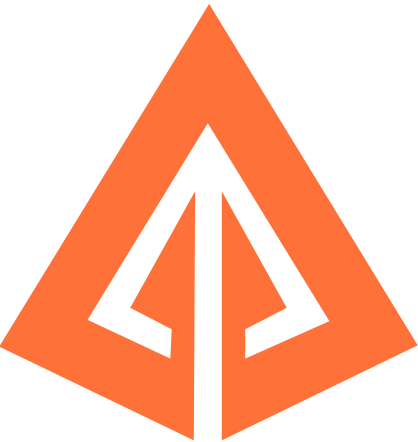
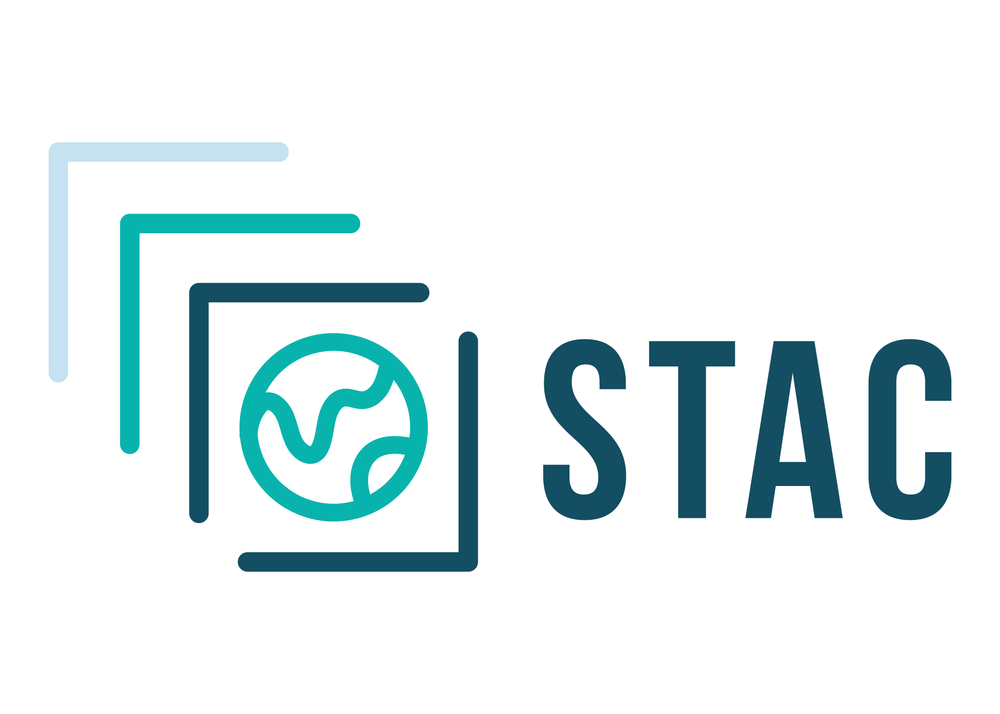

# Modules

Choose a data family to explore its loaders, writers, sources, supported formats, and related APIs. Each card links to its module overview and format guides.

## API[​](#api "Direct link to API")

### [@loaders.gl/core](https://loaders.gl/next/docs/modules/core.md)[​](#loadersglcore "Direct link to loadersglcore")

The public loaders.gl API for loading, parsing, streaming, and encoding data across format modules.

[loader-utils](https://loaders.gl/next/docs/modules/core/loader-utils.md) · [worker-utils](https://loaders.gl/next/docs/modules/core/worker-utils.md) · [schema](https://loaders.gl/next/docs/modules/core/schema.md) · [schema-utils](https://loaders.gl/next/docs/modules/core/schema-utils.md) · [scan](https://loaders.gl/next/docs/modules/core/scan.md) · [arrow-geometry](https://loaders.gl/next/docs/modules/core/arrow-geometry.md) · [geoarrow](https://loaders.gl/next/docs/modules/core/geoarrow.md) · [wkt](https://loaders.gl/next/docs/modules/core/wkt.md) · [polyfills](https://loaders.gl/next/docs/modules/core/polyfills.md)

## Formats[​](#formats "Direct link to Formats")

### [@loaders.gl/documents](https://loaders.gl/next/docs/modules/documents.md)[​](#loadersgldocuments "Direct link to loadersgldocuments")

Loaders for free-form data formats such as XML, HTML, YAML, TOML, and BSON, as well as simple Markdown documents.

[XML](https://loaders.gl/next/docs/modules/documents/xml/formats/xml.md)[TOML](https://loaders.gl/next/docs/modules/documents/config/formats/toml.md)[MD](https://loaders.gl/next/docs/modules/documents/formats/markdown.md)

### [@loaders.gl/tables](https://loaders.gl/next/docs/modules/tables.md)[​](#loadersgltables "Direct link to loadersgltables")

Read and write tabular data formats.

[CSV](https://loaders.gl/next/docs/modules/tables/csv.md)[JSON](https://loaders.gl/next/docs/modules/tables/json.md)[GeoJSON](https://loaders.gl/next/docs/modules/tables/json.md)[Avro](https://loaders.gl/next/docs/modules/tables/avro.md)[Delta Lake](https://loaders.gl/next/docs/modules/tables/parquet/api-reference/delta-table-source.md)

### [@loaders.gl/geospatial](https://loaders.gl/next/docs/modules/geospatial.md)[​](#loadersglgeospatial "Direct link to loadersglgeospatial")

Load geographic features, tracks, and vector datasets, and decode or encode geometry representations for mapping applications.

[OGCKML](https://loaders.gl/next/docs/modules/geospatial/kml.md)[GPX](https://loaders.gl/next/docs/modules/geospatial.md)[TCX](https://loaders.gl/next/docs/modules/geospatial.md)[SHP](https://loaders.gl/next/docs/modules/geospatial/shapefile.md)[OGCGeoPackage](https://loaders.gl/next/docs/modules/geospatial/geopackage.md)[OGCWKT](https://loaders.gl/next/docs/modules/geospatial/wkt.md)[OGCWKB](https://loaders.gl/next/docs/modules/geospatial/wkt.md)[TWKB](https://loaders.gl/next/docs/modules/geospatial/wkt.md)

### [@loaders.gl/images](https://loaders.gl/next/docs/modules/images.md)[​](#loadersglimages "Direct link to loadersglimages")

Decode and encode images, inspect image metadata, and work with textures and browser video APIs. See [texture formats and APIs](https://loaders.gl/next/docs/modules/images/textures.md) and [video loaders](https://loaders.gl/next/docs/modules/images/video.md).

[Images](https://loaders.gl/next/docs/modules/images/api-reference/image-loader.md)[BASIS](https://loaders.gl/next/docs/modules/images/textures/formats/basis.md)[DDS](https://loaders.gl/next/docs/modules/images/textures/formats/dds.md)[PVR](https://loaders.gl/next/docs/modules/images/textures/formats/pvr.md)[Crunch](https://loaders.gl/next/docs/modules/images/textures/formats/crunch.md)[Video](https://loaders.gl/next/docs/modules/images/video/api-reference/video-loader.md)[GIF](https://loaders.gl/next/docs/modules/images/video.md)

### [@loaders.gl/pointclouds](https://loaders.gl/next/docs/modules/pointclouds.md)[​](#loadersglpointclouds "Direct link to loadersglpointclouds")

Load point positions and attributes from survey and 3D scan files. Polygon mesh faces are also preserved when the source format supports them.

[LAS](https://loaders.gl/next/docs/modules/pointclouds/las.md)[PCD](https://loaders.gl/next/docs/modules/pointclouds/pcd.md)[PLY](https://loaders.gl/next/docs/modules/pointclouds/ply.md)

### [@loaders.gl/splats](https://loaders.gl/next/docs/modules/splats.md)[​](#loadersglsplats "Direct link to loadersglsplats")

Load Gaussian splat scene data and its rendering attributes for reconstructing and displaying captured 3D environments.

[Splat](https://loaders.gl/next/docs/modules/splats/api-reference/splat-loader.md)[KSplat](https://loaders.gl/next/docs/modules/splats/api-reference/ksplat-loader.md)[SPZ](https://loaders.gl/next/docs/modules/splats/api-reference/spz-loader.md)[RAD](https://loaders.gl/next/docs/modules/splats.md)

### [@loaders.gl/tiles](https://loaders.gl/next/docs/modules/tiles.md)[​](#loadersgltiles "Direct link to loadersgltiles")

Load and manage tiled 2D maps, with vector tile decoding, tile selection and caching, and access to tile archives.

[MVT](https://loaders.gl/next/docs/modules/tiles/mvt.md)[MLT](https://loaders.gl/next/docs/modules/tiles/mlt.md)[PMTiles](https://loaders.gl/next/docs/modules/tiles/pmtiles.md)

### [@loaders.gl/tiles-3d](https://loaders.gl/next/docs/modules/tiles-3d.md)[​](#loadersgltiles-3d "Direct link to loadersgltiles-3d")

Traverse spatial hierarchies and load selected portions of large 3D scenes and point clouds at appropriate levels of detail.

[OGCI3S](https://loaders.gl/next/docs/modules/tiles-3d/i3s.md)[Potree](https://loaders.gl/next/docs/modules/tiles-3d/potree.md)

### [@loaders.gl/raster](https://loaders.gl/next/docs/modules/raster.md)[​](#loadersglraster "Direct link to loadersglraster")

Read georeferenced imagery, numeric raster grids, and microscopy images, and turn elevation data into terrain meshes.

[OGCGeoTIFF](https://loaders.gl/next/docs/modules/raster/geotiff.md)[LERC](https://loaders.gl/next/docs/modules/raster/lerc.md)[Terrain](https://loaders.gl/next/docs/modules/raster/terrain.md)

### [@loaders.gl/scientific](https://loaders.gl/next/docs/modules/scientific.md)[​](#loadersglscientific "Direct link to loadersglscientific")

Access multidimensional arrays, scientific metadata, weather fields, and simulation datasets.

[HDF5](https://loaders.gl/next/docs/modules/scientific/hdf5.md)[NetCDF](https://loaders.gl/next/docs/modules/scientific/netcdf.md)[Zarr](https://loaders.gl/next/docs/modules/scientific/zarr.md)[GRIB2](https://loaders.gl/next/docs/modules/scientific/grib2.md)

### [@loaders.gl/scene](https://loaders.gl/next/docs/modules/scene.md)[​](#loadersglscene "Direct link to loadersglscene")

Load 3D assets such as meshes and scene graphs, including the materials, textures, and hierarchy described by each format.

[OpenUSD](https://loaders.gl/next/docs/modules/scene/usd.md)[OBJ](https://loaders.gl/next/docs/modules/scene/obj.md)

### [@loaders.gl/archives](https://loaders.gl/next/docs/modules/archives.md)[​](#loadersglarchives "Direct link to loadersglarchives")

Access files inside archive containers, extract their contents, and write archives for storage or transfer.

[ZIP](https://loaders.gl/next/docs/modules/archives/zip.md)[TAR](https://loaders.gl/next/docs/modules/archives/tar.md)

### [@loaders.gl/graphs](https://loaders.gl/next/docs/modules/graphs.md)[​](#loadersglgraphs "Direct link to loadersglgraphs")

Load graph formats into nodes, edges, and attributes for network analysis and visualization.

[DOT](https://loaders.gl/next/docs/modules/graphs.md)[GraphML](https://loaders.gl/next/docs/modules/graphs.md)[GEXF](https://loaders.gl/next/docs/modules/graphs.md)

### [@loaders.gl/traces](https://loaders.gl/next/docs/modules/traces.md)[​](#loadersgltraces "Direct link to loadersgltraces")

Read browser, system, and distributed performance traces into structured tables for timeline visualization and analysis, with writers for supported formats.

[Chrome Trace](https://loaders.gl/next/docs/modules/traces/formats/chrome-trace.md)[Perfetto](https://loaders.gl/next/docs/modules/traces/formats/perfetto-trace.md)[OTLP](https://loaders.gl/next/docs/modules/traces/formats/otlp-trace.md)[Jaeger](https://loaders.gl/next/docs/modules/traces/formats/jaeger-trace.md)[Zipkin](https://loaders.gl/next/docs/modules/traces/formats/zipkin-trace.md)

## Services[​](#services "Direct link to Services")

### [@loaders.gl/services](https://loaders.gl/next/docs/modules/services.md)[​](#loadersglservices "Direct link to loadersglservices")

Provider authentication presets for Mapbox, Google Maps and Cesium ion.

[Package reference](https://loaders.gl/next/docs/modules/services.md)

### [@loaders.gl/ogc](https://loaders.gl/next/docs/modules/ogc.md)[​](#loadersglogc "Direct link to loadersglogc")

Support for OGC file formats and service protocols. Discover and access maps, features, coverage data, and catalog assets through geospatial standards and service protocols.

[OGCWMS](https://loaders.gl/next/docs/modules/ogc/wms.md)[OGCWFS](https://loaders.gl/next/docs/modules/ogc.md)[OGCWCS](https://loaders.gl/next/docs/modules/ogc.md)[OGCWMTS](https://loaders.gl/next/docs/modules/ogc.md)[OGCCSW](https://loaders.gl/next/docs/modules/ogc.md)[OGCAPI](https://loaders.gl/next/docs/modules/ogc.md)[STAC](https://loaders.gl/next/docs/modules/ogc/stac.md)

### [@loaders.gl/arcgis](https://loaders.gl/next/docs/modules/arcgis.md)[​](#loadersglarcgis "Direct link to loadersglarcgis")

Work with ArcGIS data services. Access hosted map, feature, imagery, and scene data through ArcGIS REST services and portal resources.

[Feature](https://loaders.gl/next/docs/modules/arcgis/arcgis-feature-server.md)[Map](https://loaders.gl/next/docs/modules/arcgis/arcgis-map-server.md)[Image](https://loaders.gl/next/docs/modules/arcgis/arcgis-image-server.md)[Vector Tile](https://loaders.gl/next/docs/modules/arcgis/arcgis-vector-tile-server.md)[Scene](https://loaders.gl/next/docs/modules/arcgis/arcgis-scene-server.md)

## Data Processing[​](#data-processing "Direct link to Data Processing")

### [@loaders.gl/compression](https://loaders.gl/next/docs/modules/compression.md)[​](#loadersglcompression "Direct link to loadersglcompression")

Optimized compression and decompression algorithms for all major compression algorithms.

[Package reference](https://loaders.gl/next/docs/modules/compression.md)

### [@loaders.gl/crypto](https://loaders.gl/next/docs/modules/crypto.md)[​](#loadersglcrypto "Direct link to loadersglcrypto")

Hashing, checksums, and digest encoding.

[Package reference](https://loaders.gl/next/docs/modules/crypto.md)

### [@loaders.gl/sql](https://loaders.gl/next/docs/modules/sql.md)[​](#loadersglsql "Direct link to loadersglsql")

SQL data sources and optional database backends. Portable scan/query utilities live in core.

[Package reference](https://loaders.gl/next/docs/modules/sql.md)

### [@loaders.gl/tile-converter](https://loaders.gl/next/docs/modules/_sections/tile-converter/api-and-guides.md)[​](#loadersgltile-converter "Direct link to loadersgltile-converter")

Programmatic APIs for converting 3D tilesets, meshes, and point clouds.

[API reference](https://loaders.gl/next/docs/modules/_sections/tile-converter/api-and-guides.md)
