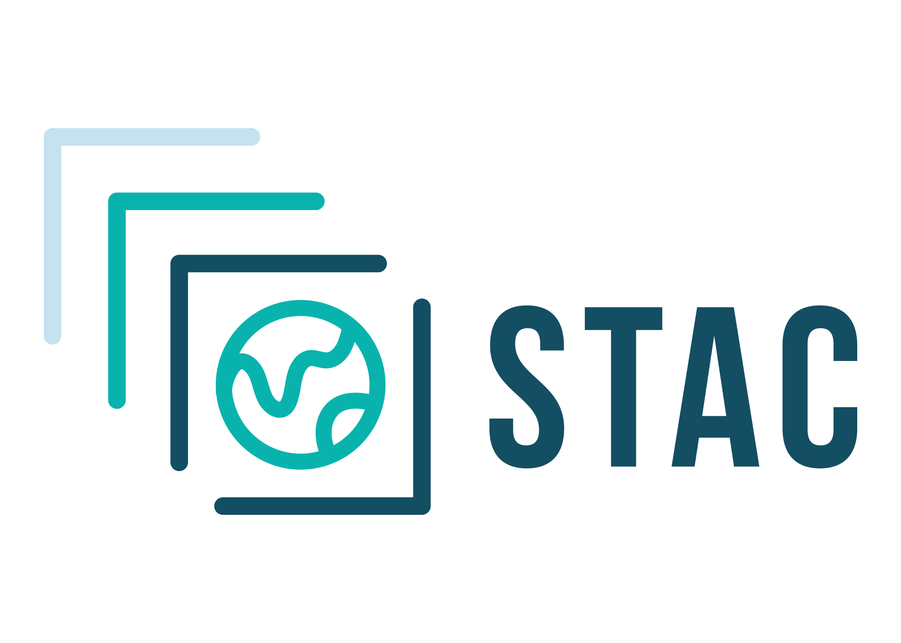

# @loaders.gl/ogc

`@loaders.gl/ogc` groups open geospatial service protocols and STAC catalog sources. The package root exports metadata loaders for asynchronous APIs. Use [WMS and OGC API sources](https://loaders.gl/next/docs/modules/ogc/wms.md) or [STAC sources](https://loaders.gl/next/docs/modules/ogc/stac.md) for format-specific APIs and explicit parser entry points.

```
import {WMSCapabilitiesLoader, STACSourceLoader} from '@loaders.gl/ogc';

import {WMSSourceLoader} from '@loaders.gl/ogc/wms';
```

WMS, WMTS, WFS, WCS, CSW, GML, and OGC API Features, Tiles, EDR, and Coverages live here. Provider credentials remain in [`@loaders.gl/services`](https://loaders.gl/next/docs/modules/services.md), and ArcGIS has its own [`@loaders.gl/arcgis`](https://loaders.gl/next/docs/modules/arcgis.md) package.

## Sources and credits[​](#sources-and-credits "Direct link to Sources and credits")

See the [package source and license inventory](https://github.com/visgl/loaders.gl/blob/master/modules/ogc/THIRD-PARTY-NOTICES.md) and the project-wide [Attributions and Credits](https://loaders.gl/next/docs/references-and-credits.md).

## Format guides[​](#format-guides "Direct link to Format guides")

* [STAC](https://loaders.gl/next/docs/modules/ogc/stac/formats/stac.md)
* [CSW - Catalogue Service for the Web](https://loaders.gl/next/docs/modules/ogc/wms/formats/csw.md)
* [GML - Geography Markup Language](https://loaders.gl/next/docs/modules/ogc/wms/formats/gml.md)
* [OWS Context](https://loaders.gl/next/docs/modules/ogc/wms/formats/ows-context.md)
* [WCS - Web Coverage Service](https://loaders.gl/next/docs/modules/ogc/wms/formats/wcs.md)
* [WFS - Web Feature Service](https://loaders.gl/next/docs/modules/ogc/wms/formats/wfs.md)
* [WMC - Web Map Context](https://loaders.gl/next/docs/modules/ogc/wms/formats/wmc.md)
* [WMS](https://loaders.gl/next/docs/modules/ogc/wms/formats/wms.md)
* [WMTS](https://loaders.gl/next/docs/modules/ogc/wms/formats/wmts.md)

## Package exports[​](#package-exports "Direct link to Package exports")

All exported subpaths (<!-- -->7<!-- -->)

These are the package's public exports, including format entry points, parsers, writers, sources, and worker assets.

| Format                                                                                                                  | Import subpath                                         |
| ----------------------------------------------------------------------------------------------------------------------- | ------------------------------------------------------ |
| [OGCGML](https://loaders.gl/next/docs/modules/ogc/wms/formats/gml.md)   | `@loaders.gl/ogc/gml-loader`                           |
| [STAC](https://loaders.gl/next/docs/modules/ogc/stac/formats/stac.md)  | `@loaders.gl/ogc/stac`                                 |
| [STAC](https://loaders.gl/next/docs/modules/ogc/stac/formats/stac.md)  | `@loaders.gl/ogc/stac-source`                          |
| [OGCWMS](https://loaders.gl/next/docs/modules/ogc/wms/formats/wms.md)   | `@loaders.gl/ogc/wms`                                  |
| [OGCWMS](https://loaders.gl/next/docs/modules/ogc/wms/formats/wms.md)   | `@loaders.gl/ogc/wms/bundled`                          |
| [OGCWMS](https://loaders.gl/next/docs/modules/ogc/wms/formats/wms.md)   | `@loaders.gl/ogc/wms/unbundled`                        |
| [OGCWMTS](https://loaders.gl/next/docs/modules/ogc/wms/formats/wmts.md) | `@loaders.gl/ogc/wmts-capabilities-loader-with-parser` |
