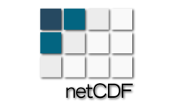

# @loaders.gl/scientific

Scientific array sources and parsers for NPY, NetCDF, Zarr, HDF5, GRIB2, and VTK. Support differs by format and encoding; the focused references below describe the implementation on master.

```
npm install @loaders.gl/core @loaders.gl/scientific
```

| Logo                                                                                                                                  | Subpath             | Public entry APIs                                                             | Reference                                                                                     |
| ------------------------------------------------------------------------------------------------------------------------------------- | ------------------- | ----------------------------------------------------------------------------- | --------------------------------------------------------------------------------------------- |
| —                                                                                                                                     | `/npy-loader`       | `NPYLoaderWithParser`                                                         | [NPYLoader](https://loaders.gl/next/docs/modules/scientific/api-reference/npy-loader.md) |
| [NetCDF](https://loaders.gl/next/docs/modules/scientific/netcdf/formats/netcdf.md) | `/netcdf`           | `NetCDFLoaderWithParser`, `NetCDFReader`, `NetCDFSource`, `openNetCDF4Source` | [NetCDF](https://loaders.gl/next/docs/modules/scientific/netcdf.md)                      |
| [Zarr](https://loaders.gl/next/docs/modules/scientific/zarr/formats/zarr.md)         | `/zarr`             | OME-Zarr, GeoZarr, generic array, and SpatialData sources                     | [Zarr](https://loaders.gl/next/docs/modules/scientific/zarr.md)                          |
| —                                                                                                                                     | `/hdf5`             | `openHDF5Source`, `HDF5Source`, experimental `HDF5TypeScriptFile`             | [HDF5](https://loaders.gl/next/docs/modules/scientific/hdf5.md)                          |
| —                                                                                                                                     | `/grib2`            | `parseGRIB2`, `GRIB2Source`                                                   | [GRIB2](https://loaders.gl/next/docs/modules/scientific/grib2.md)                        |
| [](https://loaders.gl/next/docs/modules/scientific/vtk.md)                            | `/vtk`              | `parseVTKLegacy`, `parseVTKXML`                                               | [VTK](https://loaders.gl/next/docs/modules/scientific/vtk.md)                            |
| —                                                                                                                                     | `/scientific-array` | Common scientific-array interfaces and helpers                                | Shared source contracts                                                                       |
| —                                                                                                                                     | `/vector-field`     | Vector-field processing helpers                                               | Explicit processing entrypoint                                                                |

The root exports NetCDF and Zarr metadata loaders and shared types. It does not re-export every parser or experimental source. For direct NetCDF parsing:

```
import {parse, parseSync} from '@loaders.gl/core';

import {NetCDFLoader} from '@loaders.gl/scientific';

import {NetCDFLoaderWithParser} from '@loaders.gl/scientific/netcdf';


const result = await parse(bytes, NetCDFLoader);

const synchronousResult = parseSync(bytes, NetCDFLoaderWithParser);
```

The package currently installs `h5wasm`, `zarr`, `zarrita`, and XML parsing support as dependencies. Subpath imports control which code is loaded, but do not create separate installation units.

## Sources and credits[​](#sources-and-credits "Direct link to Sources and credits")

See the [package source and license inventory](https://github.com/visgl/loaders.gl/blob/master/modules/scientific/THIRD-PARTY-NOTICES.md) and the project-wide [Attributions and Credits](https://loaders.gl/next/docs/references-and-credits.md).

`NPYLoader` and `NPYFormat` are metadata exports from the lightweight package root. For parser access use the flat `@loaders.gl/scientific/npy-loader` subpath.

## Format guides[​](#format-guides "Direct link to Format guides")

* [NumPy NPY](https://loaders.gl/next/docs/modules/scientific/formats/npy.md)
* [NetCDF](https://loaders.gl/next/docs/modules/scientific/netcdf/formats/netcdf.md)
* [Zarr, GeoZarr, and OME-Zarr formats](https://loaders.gl/next/docs/modules/scientific/zarr/formats/zarr.md)

## Package exports[​](#package-exports "Direct link to Package exports")

All exported subpaths (<!-- -->12<!-- -->)

These are the package's public exports, including format entry points, parsers, writers, sources, and worker assets.

| Format                                                                                                                                | Import subpath                            |
| ------------------------------------------------------------------------------------------------------------------------------------- | ----------------------------------------- |
|                                                                                                                                       | `@loaders.gl/scientific/grib2`            |
|                                                                                                                                       | `@loaders.gl/scientific/hdf5`             |
| [NetCDF](https://loaders.gl/next/docs/modules/scientific/netcdf/formats/netcdf.md) | `@loaders.gl/scientific/netcdf`           |
| [NetCDF](https://loaders.gl/next/docs/modules/scientific/netcdf/formats/netcdf.md) | `@loaders.gl/scientific/netcdf/*`         |
|                                                                                                                                       | `@loaders.gl/scientific/npy-loader`       |
|                                                                                                                                       | `@loaders.gl/scientific/npy-loader-types` |
|                                                                                                                                       | `@loaders.gl/scientific/npy-worker.js`    |
|                                                                                                                                       | `@loaders.gl/scientific/scientific-array` |
|                                                                                                                                       | `@loaders.gl/scientific/vector-field`     |
| [](https://loaders.gl/next/docs/modules/scientific/vtk.md)                            | `@loaders.gl/scientific/vtk`              |
| [Zarr](https://loaders.gl/next/docs/modules/scientific/zarr/formats/zarr.md)         | `@loaders.gl/scientific/zarr`             |
| [Zarr](https://loaders.gl/next/docs/modules/scientific/zarr/formats/zarr.md)         | `@loaders.gl/scientific/zarr/*`           |
